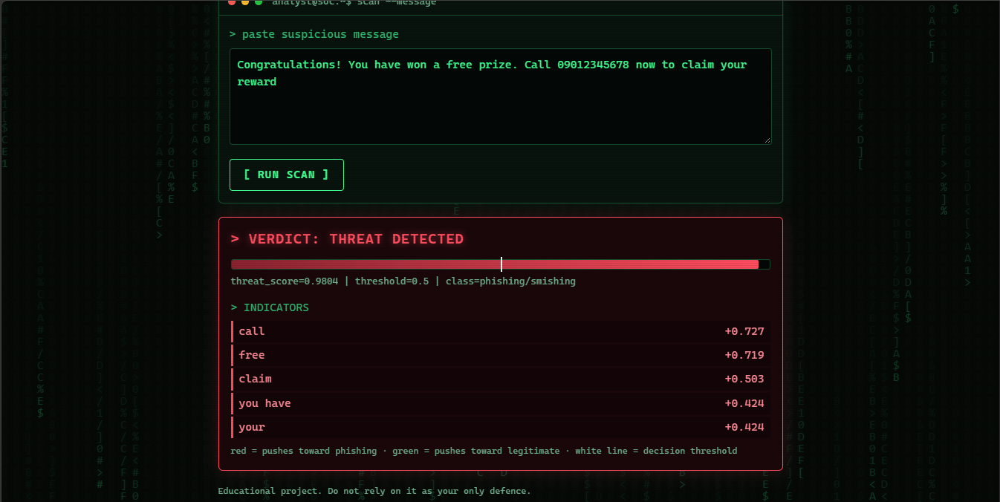

# Phishing and Smishing Detector

A machine learning tool that classifies SMS and email text as phishing/smishing or legitimate, built with an India-relevant focus (fake KYC, UPI, courier and bill-disconnection scams).

>> **Status: Phase 2 (real-data results included).** Trained and evaluated on the UCI SMS Spam Collection. The model is a general SMS spam and phishing detector, not yet specific to Indian smishing.

## What it does

- Trains and compares three text classifiers (Naive Bayes, Logistic Regression on words, Logistic Regression on characters) plus a keyword-rule baseline.
- Reports precision, recall, F1 and false-positive rate, not accuracy alone.
- Explains each prediction by showing the terms that pushed the score.
- Serves predictions through a command-line tool, a small web page and a JSON API.

## Screenshots

**Web interface: message flagged as a threat**



**Model comparison results**


## Quick start

```bash
pip install -r requirements.txt

python scripts/make_sample_data.py      # synthetic data, for testing the code only
python src/train.py                     # trains, selects, saves model and reports
python src/predict.py "Your KYC has expired, update now: bit.ly/abc123"
python src/app.py                       # web UI at http://127.0.0.1:5000
```

JSON API:

```bash
curl -X POST http://127.0.0.1:5000/api/predict \
     -H "Content-Type: application/json" \
     -d '{"text": "You have won Rs 50000, claim now"}'
```

## Project structure

```
data/        dataset notes and sample CSV
scripts/     synthetic sample data generator
src/         train.py, predict.py, app.py, detector.py
models/      saved model (created by train.py)
reports/     metrics.json, metrics.md, confusion_matrix.png
```

## Method notes

- **Split:** 60/20/20 train/validation/test, stratified. The model is chosen on validation and reported on test, so the test set never influences selection.
- **Leakage control:** duplicates are removed before splitting. Use `--dedupe-normalized` on real data to also remove near-duplicates that differ only by link or number.
- **Baseline:** a keyword rule shows what a simple approach achieves, so the ML gain can be measured.
- **Metrics:** false-positive rate is tracked because false alarms cost analyst time and erode trust in a detector.
- **Threshold:** `predict.py --threshold` trades recall against false alarms.

## Security considerations

The web app binds to localhost only, runs with debug off, caps input length, and auto-escapes user text. It is a demo, not a production service.

## Limitations

- The bundled sample is template-generated, so it is far easier than real traffic.
- A text-only model can be evaded by rewording and does not inspect link reputation.
- Mixed-language messages (Hindi, Telugu written in English letters) are not yet handled specially.

## Roadmap

- [x] **Phase 2: real data.** Train on a public SMS phishing dataset and report real metrics here (table below).
- [ ] Add a character-level model comparison on the real data and discuss the errors.
- [ ] Add SHAP explanations.
- [ ] Fine-tune DistilBERT (or a multilingual model) and compare it with the baselines.
- [ ] Add URL features (length, domain age, suspicious tokens) as a second signal.
- [ ] Add a small evaluation of Hinglish / Telugu-English messages.

## Results

Evaluated on a held-out test set from the UCI SMS Spam Collection (stratified split; model selected on a separate validation set).

| Model | Dataset | Precision | Recall | F1 | False-positive rate |
|---|---|---|---|---|---|
| Keyword baseline | UCI SMS Spam | 0.825 | 0.266 | 0.402 | 0.008 |
| Naive Bayes (word) | UCI SMS Spam | 1.000 | 0.419 | 0.591 | 0.000 |
| Logistic Regression (word), selected on validation | UCI SMS Spam | 0.906 | 0.927 | 0.916 | 0.013 |
| Logistic Regression (char) | UCI SMS Spam | 0.943 | 0.935 | 0.939 | 0.008 |
| DistilBERT | not yet run | | | | |

## Error analysis

On the test set (1,028 messages, 124 spam) the selected model missed 9 spam messages and wrongly flagged 12 legitimate ones. No error was extreme: false alarms scored 0.51 to 0.82, and 8 of the 9 missed spam messages scored 0.28 to 0.48.

**Missed spam (9)**
- 3 read like ordinary conversation or a horoscope, with none of the usual trigger words.
- 4 are brand marketing or consumer-complaint style messages that mention companies or bills without typical spam vocabulary.
- 2 are premium-rate or subscription messages just under the threshold (scores 0.45 and 0.48); one has words and prices run together, which word-level features handle poorly.

**False alarms (12)**
- 5 are short personal messages containing "call" or "free", words that are strong spam cues in this dataset and are over-weighted.
- 1 is a genuine bank security notice that uses phishing-like vocabulary, a limit of text-only classification.
- The rest are very short, low-information messages that scored just above 0.5.

**Takeaways**
- The 0.5 threshold is a default, not a choice. A precision-recall curve should be used to pick it.
- Several false alarms are informal regional-English messages. With only 12 examples this is a hypothesis, but it suggests weak generalization to Indian-English text and motivates an India-focused smishing dataset.
- Some "missed" messages look like person-to-person text, so label noise is possible; labels were not manually audited.
- Planned improvements: character n-gram features for obfuscated text, URL and phone-number features, and threshold tuning.

**Notes**
- The logistic regression models catch about 93% of spam, against 27% for the keyword rule.
- Naive Bayes has no false alarms but misses most spam because the data is imbalanced.
- The two logistic regression models differ by roughly one message on the test set, so I treat them as equal.
- This is one train/test split on a general SMS spam dataset, not an Indian smishing dataset.

## Author

Cybersecurity student project. Built for learning and portfolio use.
